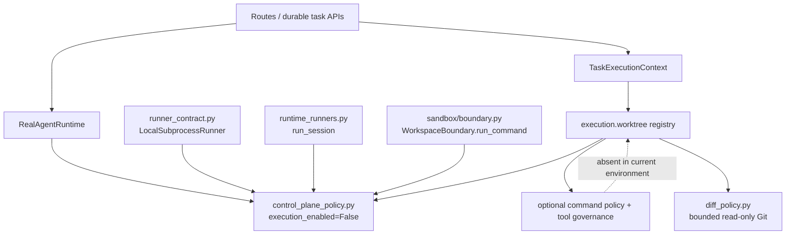

# AETHERION AI — Trusted Process Supervisor and Governance Architecture Decision

**Review date:** 2026-10-16  
**Review type:** Read-only architecture decision and release-assurance review  
**Approved current scope:** Option B — control-plane only  
**Architecture decision:** **Keep Option B; defer execution-enabled supervisor**  
**Implementation status:** **Architecture only — not implemented**

## 1. Executive decision

### Current release decision

Ship only the existing Option B control-plane behavior, subject to the broader
release gates already outstanding. Autonomous agent execution, command
execution, plugin execution, untrusted worker execution, physical worktree
creation/removal, process attachment, and governance-dependent alternate
worktree Git inspection must remain unavailable unless their current source and
dependency contracts already permit them.

The central policy in `backend/execution/control_plane_policy.py` is a source
lock: `get_control_plane_policy()` always returns `execution_enabled=False`.
Environment values describe or validate configuration but cannot enable
execution. This review does not authorize changing that lock.

### Future decision

The repository needs a separately approved **Trusted Execution Supervisor**
before it can safely support execution-enabled worktree children. That future
component should own process creation and registration in one trusted boundary;
it should not merely pass a random token to existing generic subprocess callers.
The current process-local capability map is a useful enforcement primitive, but
it is not yet a complete supervisor or a production creator-to-registration
handoff.

### Governance decision

The missing governance functionality is both:

1. a real package/layout problem (`backend/security.py` is a module, so
   `security.command_policy` cannot resolve as a submodule); and
2. an absent implementation/dependency (`execution.tool_governance` is not
   present in the repository environment).

The correct future fix is a documented canonical governance package and stable
contract, not a raw subprocess fallback and not an import alias that hides the
missing policy engine.

**Recommendation:** choose **Option A now**. Approve a future Option B-style
execution supervisor and governance package only as a design gate; implement it
later under a separate execution approval with real governance dependencies,
isolated integration evidence, and a reversible rollout.

## 2. Evidence labels and review boundary

This report distinguishes:

- **SOURCE** — directly observed in current repository files;
- **TEST** — directly observed in existing focused test output recorded by the
  prior implementation/follow-up work, not rerun in this read-only review;
- **CUSTODY** — directly observed current status/hash evidence;
- **INFERENCE** — a security or architecture conclusion from source facts; and
- **PROPOSED** — a future design recommendation, not an implementation claim.

No source, test, configuration, environment, deployment asset, or existing
report was changed. No process, service, worker, container, database,
governance service, branch, actual worktree, or project index was mutated.

The requested prior independent report name ending in
`_INDEPENDENT_SECURITY_AUDIT.md` is not present. The existing closest report is
`AETHERION_OPTION_B_RESIDUAL_SECURITY_REMEDIATION_INDEPENDENT_AUDIT.md`; it was
used and preserved. This filename discrepancy is a provenance limitation.

## 3. Present repository custody

**CUSTODY — current read-only capture:**

| Item | Observed value |
|---|---|
| Branch | `main` |
| HEAD | `5c7bdcd4808a178aa677488f18b948a747f94193` |
| Status entries | 2,238 |
| Untracked entries | 2,237 |
| Modified/staged entries | 1 — pre-existing `backend/routes/d3_features.py` |
| `.git/index` SHA-256 | `18fc638834262aff249e3bddb5bf1ff23f3fca3c85adf22d4a6499168ae2ab3e` |
| `.git/index.lock` | Absent |
| Protected D3 SHA-256 | `592e397ec9d8edf583661c2ead5852780f9bbfb96515ab997f556001783d6f5c` |
| Current architecture report | Absent before this report |

Relevant preserved report hashes:

| Report | SHA-256 |
|---|---|
| `AETHERION_OPTION_B_PROCESS_LIFECYCLE_GOVERNANCE_FOLLOWUP_REPORT.md` | `fc7a0749d7dc26acfe1841d467de766532e7e5c51e762ba8035814348faaec98` |
| `AETHERION_OPTION_B_UNIFIED_DIFF_BOUNDARY_REMEDIATION_REPORT.md` | `028af84d98c9ea8042f4e3fbdaaa636cde610cf2a6bf9bbfa39fdfb2c12f1c7c` |
| `AETHERION_OPTION_B_RESIDUAL_SECURITY_REMEDIATION_INDEPENDENT_AUDIT.md` | `73a4c676073f57e2d37c7948f3e6e680755471f7ff65d92adff4b21df689ed80` |
| `AETHERION_OPTION_B_RESIDUAL_SECURITY_REMEDIATION_IMPLEMENTATION_REPORT.md` | `f8f3e40c02d9f741d290c9a9597eb50e03573d6155ff47c4a481c6cf309e13f4` |
| `AETHERION_OPTION_B_RESIDUAL_HARDENING_INDEPENDENT_SECURITY_AUDIT.md` | `a49bdd89982174377df640eac0550e1536d5007fd204620e871a7a6a0cf9c6c3` |

The extensive untracked tree means the status count and hashes are custody
evidence, not a complete semantic inventory of every untracked file.

## 4. Current architecture at a glance

The actual repository is a Python backend with several execution-oriented
subsystems, but the approved release source-locks execution off. The relevant
layers are:



**SOURCE:** The diagram describes current source relationships; the future
supervisor and governance package are not present components.

## 5. Verified current-state architecture

### 5.1 Worktree registry and sealed capability

**SOURCE:** `backend/execution/worktree.py` contains the current worktree
registry:

- `_REGISTRY` maps worktree IDs to `Worktree` objects under `_REGISTRY_LOCK`.
- `Worktree` contains worktree ID, session ID, execution ID, task ID, tenant ID,
  branch, path, base ref, repository root, status, and timestamps.
- `_ProcessOwnershipCapability` is sealed by the private `_CAPABILITY_SEAL` and
  contains worktree/tenant/session/execution identity plus a private nonce.
- `_PROCESS_CAPABILITIES` stores capability objects separately from `Worktree`.
- `Worktree.to_dict()` serializes only the dataclass fields; it does not contain
  the capability or the private map.

`create_worktree()` performs the following current sequence:

```text
assert_agent_execution_enabled()
  -> _require_governance()
  -> tenant context lookup
  -> confined worktree path construction
  -> governed Git worktree_add
  -> Worktree object construction
  -> registry + private capability insertion under _REGISTRY_LOCK
  -> event/telemetry emission
  -> return Worktree (not capability)
```

The critical fact is the final handoff: the function returns a `Worktree`, not
the capability. No public or internal capability-recovery function exists.
This is safe for the current locked release, but it means no process creator can
currently consume the capability through a production call chain.

### 5.2 Attachment and teardown

`attach_process()` currently requires, in order:

1. `assert_agent_execution_enabled()`;
2. a `_ProcessOwnershipCapability` object, rejecting an owner string;
3. tenant/session/execution matching through `get_authorized_worktree()`;
4. identity matching against the exact object in `_PROCESS_CAPABILITIES`;
5. a concrete `subprocess.Popen` instance; and
6. active status plus duplicate prevention under `_REGISTRY_LOCK`.

This is a good fail-closed boundary for an already-issued internal capability,
but a `Popen` type check is not process ownership evidence. The current source
does not bind a handle to PID start identity, creator runtime, command digest,
parent runtime, or OS process handle identity.

`_terminate_children()` transitions an active worktree to `retiring` under the
same lock before taking a snapshot of registrations. It performs:

```text
poll -> terminate -> wait(grace) -> kill only after TimeoutExpired -> wait(grace)
```

Failed registrations remain in `_PROCS` for retry. `discard_worktree()` refuses
physical removal while handles remain. These controls address in-process race
and retry behavior, but they do not create a missing production registration
lifecycle.

### 5.3 Actual process-creation callsites

**SOURCE:** Repository search found these actual `backend/` `Popen` boundaries:

| Callsite | What it owns | Worktree relationship |
|---|---|---|
| `backend/execution/diff_policy.py:run_bounded_readonly_git()` | A bounded read-only Git inspection process | No worktree child ownership; it is a short-lived inspection helper. |
| `backend/execution/runner_contract.py:LocalSubprocessRunner.submit()` | A temporary script under a `JobSpec`-specific temporary directory | No `Worktree`, capability, or `attach_process()` call. It is blocked by `assert_agent_execution_enabled()`. |
| `backend/execution/runtime_runners.py:run_session()` | A session/agent subprocess using `session_workspace(sid)` and a generated `execution_id` | No registry `Worktree` creation or capability handoff. It is blocked before launch. |
| `backend/execution/sandbox/boundary.py:WorkspaceBoundary.run_command()` | A command under the workspace boundary | No worktree capability or registry registration. It is blocked at the actual Popen boundary. |

No current backend process creator both establishes a registered worktree and
registers its returned process with `attach_process()`. This is a **SOURCE**
finding confirmed by the follow-up report's repository-wide search; it is not
an inference from test names.

### 5.4 Current agent/runtime call chain

`RealAgentRuntime.__init__()` calls `assert_agent_execution_enabled()` before
constructing the boundary, tools, providers, plugins, or memory/session
components. Its task context may later attach a worktree through the context
module, but this runtime constructor does not create a child process or receive
the worktree capability.

`TaskExecutionContext.attach_execution_worktree()` calls `create_worktree()`;
`cleanup_execution_worktree()` calls `discard_worktree()`. Neither path has a
process creator between those operations. The runtime's tool and provider paths
are execution-capable but are gated before they can become a trusted worktree
child lifecycle.

`runtime_runners.run_session()` creates an execution ID and session workspace,
then eventually calls `subprocess.Popen`. Its identity tuple is useful future
input, but it is not currently tied to a `Worktree` registry entry or a sealed
capability. Treating that tuple as ownership would be an unsafe design shortcut.

### 5.5 Current permitted and prohibited behavior

**SOURCE / INFERENCE:** Under the approved Option B release:

Permitted or retained:

- authentication and tenant-scoped durable task history;
- sanitized task status and review records;
- bounded diff extraction through the current approved paths, subject to their
  governance/authorization limitations;
- read-only registry inspection helpers that do not launch processes; and
- narrow cleanup logic only when internal handles already exist, while public
  cleanup entrypoints remain execution-gated.

Prohibited or unsupported:

- autonomous agent startup;
- command, plugin, provider, or untrusted worker execution;
- physical worktree creation/removal/prune/branch deletion;
- arbitrary process attachment or capability retrieval;
- generic runner/sandbox/session `Popen` launch;
- governed alternate worktree Git execution when required governance is absent;
  and
- any fallback from a failed ownership/governance check to execution.

## 6. Governance integration diagnosis

### 6.1 Observed import and layout facts

**SOURCE / CUSTODY:** The current `worktree.py` imports:

```python
from security.command_policy import CommandDecision, global_command_policy
from execution.tool_governance import get_tool_governance
```

The current repository has `backend/security.py`, not a `security/` package with
`command_policy.py`. With the repository's `backend` path available as a flat
import root, Python resolves `security` to that application module. A module
does not have a package `__path__`, so `security.command_policy` cannot resolve.
This is a **module/package naming collision**.

No `execution/tool_governance.py` or equivalent in-repository implementation was
found. `execution` is the flat import namespace mapped to `backend/execution`;
the requested module is absent. This is a **missing implementation or missing
dependency**, not merely the same collision.

Other optional worktree integrations (`workspace_lock`, `infra.tenant`, truth
kernel, events, event bus, telemetry) are also absent in the current local
environment. The worktree module intentionally treats missing governance as a
denial, not a bypass.

There is no evidence in this repository proving that these modules belong to a
separate deployed package or another repository. That ownership question must be
resolved before implementation. The current status is therefore:

| Question | Decision |
|---|---|
| Is `security.command_policy` a valid current package? | No — `security.py` shadows the expected package. |
| Is `execution.tool_governance` implemented locally? | No evidence; import is absent. |
| Is a dependency lock or package manifest proving an external provider? | Not established by this review. |
| Do test doubles prove the real modules? | No. They prove adapter sequencing only. |
| Is raw subprocess fallback acceptable? | No; it would bypass the required admission boundary. |

### 6.2 Current bounded Git admission

The alternate `worktree_diff()` path validates an exact bounded argv shape, then
requires governance through `_require_governance()`, calls `before_dispatch()`,
checks the policy-preserved argv, and only then calls
`run_bounded_readonly_git()`. The bounded runner owns argv, cwd, pipes, shell
mode, timeout, and output limits.

**SOURCE:** `D3Store.get_worktree_diff()` uses tenant-scoped persisted metadata,
root/path validation, and the shared bounded extractor, but it currently calls
the shared runner directly rather than the optional command-governance adapter.
That is a separate architecture boundary. A future governance gate must decide
whether D3 read-only Git is an explicitly authorized control-plane operation or
whether it must use the same command-policy adapter. It must not silently become
an ungoverned mutation-capable path.

### 6.3 Proposed canonical package contract

**PROPOSED — not present or implemented.** Avoid adding a second flat namespace
that can collide with `backend/security.py`. The minimum future design should
choose one canonical package, for example:

```text
backend/execution/governance/
    __init__.py
    command_policy.py
    tool_governance.py
```

The import contract should be explicit and versioned. Renaming or moving the
existing `backend/security.py` is a separate compatibility decision; this report
does not recommend doing it implicitly.

#### Governance contract table

| Contract | Required behavior | Security requirement |
|---|---|---|
| `validate_git_action(action, argv)` | Closed action set and exact argv shape | Reject unknown actions, aliases, mutation-shaped argv under read-only labels, NULs, and option injection before dispatch. |
| `before_dispatch(tool, action, identity, workspace)` | Return immutable allow/deny/escalate decision and audit ID | Identity, tenant, session, execution, worktree, and release scope come from trusted context; caller cannot select policy outcome. |
| `build_safe_popen_kwargs(argv, cwd, timeout)` | Provide sanitized environment/startup settings | Must preserve exact argv and trusted cwd; must not return shell-enabled or caller-controlled redirection settings. |
| `run_bounded_readonly_git()` handoff | Start only after admission | Bounded runner owns pipes, timeout, shell false, output budgets, and complete-result semantics. |
| `after_dispatch(decision, result)` | Record return code, timeout, denial, and bounded failure | Must be best-effort telemetry without converting a failure into success or exposing command/output secrets. |
| Missing module/dependency | Deny before subprocess | No import fallback, raw `subprocess.run`, environment bypass, or permissive default. |
| Physical mutation action | Deny before governance and subprocess in Option B | `worktree_add`, `worktree_remove`, `worktree_prune`, and `branch_delete` remain source-locked. |

The canonical API should receive an argv list and structured identity, not an
untrusted command string. If a compatibility layer derives a governance string,
it must round-trip back to the exact argv and reject any mismatch rather than
silently replacing the caller's command.

### 6.4 Minimum future integration work

**PROPOSED:** Before any real governance claim:

1. decide whether governance is a local backend package or a separately
   versioned dependency;
2. create a package layout that cannot be shadowed by `backend/security.py`;
3. define and version the contract table above;
4. add dependency/installation evidence and an offline-safe test fixture;
5. run real module import and read-only Git admission in an isolated disposable
   repository; and
6. rerun negative mutation and missing-governance tests with the real modules.

No implementation phase should use test doubles as a substitute for steps 1–5.

## 7. Option A versus future execution-enabled Option B

| Dimension | Option A — current control plane | Future execution-enabled supervisor |
|---|---|---|
| Security risk | Lowest: no new child ownership or execution authority | Higher: introduces process, filesystem, command, provider, and worker authority; must be bounded by a new trust boundary |
| Scope | No production code change required for this decision | New supervisor, governance package, process identity evidence, durable lifecycle, observability, and isolated integration environment |
| Complexity | Existing policy and bounded diff controls | High: launch/registration/retirement races, PID reuse, multi-worker ownership, cleanup retry, capability revocation, governance admission |
| Rollback | Keep the source lock; unsupported paths remain denied | Feature and source lock must permit immediate return to Option A without leaving children or worktrees unmanaged |
| Testability | Fake process and negative policy tests are sufficient for current scope | Requires synthetic unit tests plus real isolated governance and process-supervision integration tests before enablement |
| Release implication | Suitable only for the approved control-plane scope, not general execution | Not releasable until separate authority approves execution and all gates in §12 pass |
| Recommendation | **Choose now** | **Design only; defer implementation/enablement** |

Option A is not a claim that every broader repository feature is production-ready.
It is the safest decision for the explicitly approved release scope because the
current architecture lacks both a trusted process handoff and real governance
modules.

## 8. Proposed future trusted process supervisor

This section is a design proposal only. It is not implemented in the current
repository and does not authorize changing the Option B source lock.

### 8.1 Trust boundary

The future `TrustedProcessSupervisor` should be the only component permitted to
launch a child that is intended to write to an execution worktree. Generic
runner, session, and sandbox modules must not independently decide that a child
is worktree-owned.

```mermaid
sequenceDiagram
    participant Caller as Approved runtime caller
    participant Sup as TrustedProcessSupervisor
    participant Reg as Worktree/lifecycle registry
    participant Gov as Governance adapter
    participant OS as OS process API
    participant Reap as Cleanup/reaper

    Caller->>Sup: launch_owned(identity, worktree_ref, command_spec)
    Sup->>Reg: atomic check active + identity + root + generation
    Reg-->>Sup: trusted lifecycle record
    Sup->>Gov: before_launch(exact argv, identity, worktree)
    Gov-->>Sup: allow/deny + audit decision
    Sup->>OS: launch exact argv, trusted cwd/env
    OS-->>Sup: process handle + pid/start identity
    Sup->>Reg: atomic register(handle identity, capability generation)
    alt registration fails
        Sup->>Reap: terminate/wait/kill bounded cleanup
        Sup->>Reg: mark failed_cleanup; retain evidence
        Sup-->>Caller: sanitized failure
    else registration succeeds
        Sup-->>Caller: opaque internal OwnedProcessHandle
    end
    Caller->>Sup: retire(worktree generation)
    Sup->>Reg: active -> retiring under lock/CAS
    Sup->>Reap: owned handle cleanup only
    Reap->>OS: terminate, bounded wait, kill only on timeout
    Reap->>Reg: exited/discarded or failed_cleanup
```

The caller should not receive a capability by worktree ID. The preferred design
is that `launch_owned()` itself performs creation and registration, returning an
opaque internal handle that cannot be serialized. If a separate creator is
unavoidable, it receives a one-shot private `LaunchPermit` through an internal
call only; the supervisor consumes it at launch and binds the returned process
identity immediately.

### 8.2 Capability and identity binding

**PROPOSED minimum capability fields, retained only in supervisor memory:**

- random unguessable nonce and capability generation;
- worktree ID and immutable worktree record generation;
- tenant ID, session ID, and execution ID;
- supervisor/runtime instance ID;
- canonical resolved worktree path and repository root identity;
- command/argv digest and approved launch policy ID; and
- issuance and expiry timestamps.

The capability is not sufficient by itself. Registration must additionally bind
the returned process to OS-level identity evidence:

- native process handle where the platform supports one;
- PID plus process-start identity, never PID alone;
- parent/supervisor instance relationship where reliable;
- canonical command identity or launch nonce returned by the supervisor; and
- the exact worktree cwd/root used at launch.

For POSIX-like systems, a future implementation should evaluate pidfds and
`/proc` start-time evidence where available. For Windows, it should retain a
native process handle and creation-time evidence. If strong identity cannot be
verified, registration must fail closed rather than falling back to PID-only
termination.

### 8.3 Lifecycle state machine

**PROPOSED:** Keep worktree state and child-process state distinct but linked by
an immutable lifecycle generation.

```text
worktree: creating -> active -> retiring -> discarded
                         |          |
                         v          v
                       failed    failed_cleanup

process:  launch_pending -> registering -> owned -> exiting -> reaped
                                  |             |
                                  v             v
                           registration_failed  cleanup_failed
```

Required invariants:

1. A process can enter `owned` only after exact identity and lifecycle-generation
   checks succeed.
2. `retiring` prevents new registration atomically.
3. A discarded or failed generation cannot accept a capability from a newer or
   reused worktree ID.
4. A failed registration never returns success and triggers immediate bounded
   cleanup of the just-created handle.
5. `failed_cleanup` retains the same trusted handle/evidence for retry; it does
   not expose a generic kill-by-ID operation.
6. Identifier reuse requires a new generation and new capability nonce; old
   capabilities are invalid even if the textual ID is reused.

### 8.4 Concurrency and cleanup

Use one authoritative per-worktree lifecycle lock or compare-and-swap record for
the following critical transitions:

- active → retiring;
- capability consumption and registration;
- duplicate registration rejection;
- process exit observation; and
- cleanup handle removal.

The lock must prevent both of these interleavings:

```text
attach checks active ---- retire marks retiring ---- attach appends
```

and:

```text
retire snapshots handles ---- attach appends ---- retire removes worktree
```

Cleanup should use bounded `terminate → wait(grace) → kill only after timeout →
wait` behavior. A process that exits during the grace wait must not receive an
unnecessary kill. A failed wait/kill/identity check retains the trusted handle
and marks incomplete cleanup; it must never silently remove the handle and
continue with worktree deletion.

### 8.5 Auditability and errors

Every launch, admission, registration, duplicate rejection, retirement, process
exit, cleanup retry, and failed cleanup should emit an audit event containing
only sanitized identity references, generation, decision ID, exit class, and
bounded timing. Never log command secrets, environment values, process output,
tokens, or unsafe host paths.

Public responses should expose stable error codes such as
`EXECUTION_DISABLED`, `GOVERNANCE_UNAVAILABLE`, `PROCESS_REGISTRATION_FAILED`,
`WORKTREE_RETIRED`, and `PROCESS_CLEANUP_INCOMPLETE`, not exception text or
capability material.

## 9. Threat model for a future supervisor

| Threat | Current exposure/status | Required future control |
|---|---|---|
| Forged capability object | Current seal is private and attachment requires object identity, but Python in-process code with arbitrary module access is not a hostile-code sandbox | Keep capability private to supervisor; do not expose a lookup API; isolate untrusted workers from supervisor memory/process. |
| Caller-supplied PID or owner string | Current `owner_token` is rejected and attachment requires an internal capability plus `Popen` type | Never accept PID/string as ownership evidence; bind a native handle and start identity created by the supervisor. |
| Stale worktree ID | Current active/identity checks reject stale records | Add lifecycle generation/epoch and capability expiry; reject old generation even if ID is reused. |
| Cross-tenant/session/execution attachment | Current identity tuple checks reject mismatch | Derive identity from trusted runtime context and durable record; never accept caller-controlled identity as the sole authority. |
| Duplicate registration | Current object/capability duplicate check exists | Make registration one-shot/atomic in supervisor; record process identity and reject any second consumer. |
| Race with retirement | Current lock transitions active to retiring before cleanup | Keep one authoritative CAS/lock around capability consumption, retirement, and handle list mutation. |
| PID reuse | Current code has no PID/start-time binding | Use native process handle/pidfd/start-time evidence; fail closed if unavailable. |
| Registration failure after launch | Current architecture has no creator handoff to handle this | Supervisor must clean the exact just-created handle before returning failure; retain failed-cleanup evidence for retry. |
| Terminating another tenant's process | Current attachment is not reachable in Option B and identity checks are local | Bind handle to immutable identity and generation; verify before every cleanup action; no kill-by-ID endpoint. |
| Process escapes worktree | Current generic runners are not proven worktree-owned | Supervisor owns cwd/root selection, launch policy, mount/sandbox configuration, and post-launch identity. |
| Missing governance | Current alternate path denies; D3 governance boundary is not uniform | Missing package/decision must deny every governed launch/read path; no raw subprocess fallback. |
| Malicious command/argv retokenization | Current bounded alternate adapter checks exact argv after policy construction | Use structured argv as canonical input, exact round-trip checks, closed action set, and mutation-specific denial. |
| Secret leakage in audit/error paths | Current bounded diff/error policies sanitize public responses | Redact outputs, cap logs, use stable codes, and prohibit capability/environment serialization. |

## 10. Option A acceptance and future approval gates

### A. Current release gate — Option A

The current release remains in Option A when all of the following are true:

- the source lock resolves `execution_enabled=False` regardless of environment;
- runtime, runner, sandbox, worker, plugin, command, worktree-creation, and
  process-attachment boundaries reject before real launch or mutation;
- bounded diff paths fail closed on missing authorization, root, governance, or
  resource evidence;
- physical Git mutation actions remain denied before governance/subprocess;
- no capability-retrieval API or serialized ownership token exists; and
- current report/test evidence remains preserved and reviewable.

### B. Future execution approval gate

Changing the source lock requires an explicit release-authority decision outside
this document. The decision package must include:

1. accepted supervisor architecture and threat model;
2. accepted governance package owner and versioned contract;
3. verified worktree/session/tenant identity source;
4. OS-specific process identity strategy;
5. rollback plan that returns to Option A without orphaned children;
6. isolated integration evidence; and
7. explicit sign-off that execution, command, plugin, and worker authority may
   be enabled.

An environment variable, passing synthetic unit test, or this architecture
document is not approval.

### C. Architecture gate

Before implementation is authorized, the design must be accepted if it proves:

- supervisor-only launch boundary;
- one-shot private capability/permit handoff;
- immutable identity and lifecycle generation binding;
- atomic registration versus retirement;
- OS-specific process identity and PID-reuse handling;
- failed-registration cleanup and retryable failed cleanup;
- no public capability recovery; and
- sanitized events/errors with bounded output.

### D. Governance gate

Before governed Git or execution can be certified:

- a canonical package namespace resolves without the `security.py` collision;
- `command_policy` and `tool_governance` implementations are present and
  versioned in the approved runtime environment;
- the exact contract table in §6.3 is implemented;
- read-only D3 and alternate worktree paths have an explicit governance policy;
- all four mutation actions remain denied before subprocess; and
- real modules, not doubles, execute an isolated read-only Git admission test.

### E. Test gate

The future implementation needs all of the following:

**Synthetic unit tests:** capability non-serialization, identity mismatch,
stale generation, duplicate registration, retirement race, fake process exit,
timeout ordering, failed cleanup retention, missing governance, denial,
retokenization, and Option B lock assertions.

**Isolated integration tests:** real governance imports, disposable repository,
real read-only Git only, exact argv/audit events, bounded stdout/stderr and
timeout behavior, worktree root confinement, and a supervisor-created fake or
platform-isolated process handle strategy. Any test that launches a real child
must run only after separate execution approval in a disposable environment;
the current Option B suite must not be changed to do so.

### F. Production-readiness gate

Outside this task, production would additionally require source/image
provenance, deployment alignment, secrets management, authentication and tenant
authorization evidence, OS/runtime hardening, monitoring/alerting, process
orphan recovery, database/Redis behavior, rollback rehearsal, and documented
operator ownership. The current report set does not certify these items.

### G. Rollback and stop conditions

Any missing governance module, identity mismatch, capability mismatch, stale
generation, failed registration, cleanup timeout, unavailable process identity,
or supervisor audit failure must leave the system in a denied or incomplete
state. The only safe fallback is Option A control-plane behavior. There must be
 no automatic fallback from a denied execution request to a raw subprocess, cwd
 inference, PID kill, or ungoverned Git operation.

## 11. Acceptance matrix

| Requirement | Current evidence | Gap | Proposed design decision | Verification required | Approval owner/decision needed | Go/no-go effect |
|---|---|---|---|---|---|---|
| Option B remains locked | **SOURCE/TEST:** source lock and Phase 2/legacy tests | None for current scope | Keep source lock unchanged | Rerun policy/negative suites at every release | Release authority | Any failure is no-go |
| Worktree-owned process creator exists | **SOURCE:** no qualifying caller | No trusted creator-to-capability handoff | Add supervisor-only launch boundary in future | Source trace plus isolated launch/registration test | Architecture authority | No execution enablement without it |
| Capability is lifecycle-bound | **SOURCE:** private seal/map; no serialization | No generation/expiry or supervisor launch binding | One-shot private permit bound to supervisor/runtime/worktree generation | Synthetic forgery, reuse, and serialization tests | Security/architecture authority | Failure is no-go |
| Process identity is genuine | **SOURCE:** current code only checks `Popen` type | No PID start/native handle/creator evidence | Bind native handle plus OS start identity and command/cwd digest | OS-specific isolated integration tests | Platform/runtime authority | Unsupported platform is no-go or explicitly excluded |
| Retirement is race-safe | **SOURCE/TEST:** current registry lock and fake tests | No multi-worker durable supervisor | Atomic lifecycle CAS/lock and generation | Deterministic race plus supervisor integration | Architecture authority | Race failure is no-go |
| Failed registration is safe | **SOURCE:** no current handoff | No launch-failure cleanup contract | Supervisor cleans exact handle; marks retryable failed cleanup | Fake launch failure and isolated integration | Security authority | Any leaked running handle is no-go |
| Cleanup cannot target another process | **SOURCE:** current capability/identity checks; no OS evidence | PID reuse and handle identity unresolved | Native handle/start identity verification before signal | PID-reuse/exit/tenant mismatch tests | Platform/security authority | No-go if identity weakens to PID only |
| Governance package resolves | **SOURCE:** collision and missing module observed | No real implementation/dependency | Canonical `backend.execution.governance` or approved external package | Real import in target runtime | Dependency/release authority | No governed-operation certification |
| Exact argv admission | **SOURCE/TEST:** adapter doubles and shape checks | Real governance contract absent | Structured argv, closed action set, before/after audit | Real-module disposable Git test | Governance authority | No-go on retokenization or bypass |
| D3 Git governance boundary | **SOURCE:** D3 uses persisted auth + bounded runner, not optional adapter | Uniform command-policy decision not established | Explicitly govern D3 read path or document separate read-only policy | Real D3 disposable fixture and audit event test | Governance/architecture authority | Must be resolved before execution-enabled certification |
| Option A rollback | **SOURCE:** source lock and denied paths | No future supervisor rollback rehearsal | Kill switch is source-controlled and leaves children safely managed | Isolated rollback/orphan rehearsal | Release authority | No rollout without rollback evidence |
| Production readiness | **SOURCE:** prior reports disclose gaps | Infrastructure/provenance/monitoring not covered | Separate production gate after technical gates | Deployment and rollback evidence | Release authority | Not covered by this decision |

## 12. Recommended decision and next action

### Recommended decision

Accept **Option A** as the only currently supportable release architecture.
Record the trusted supervisor and governance package described here as a future
architecture decision, not as an implementation commitment or execution approval.

Do not wire `runtime_runners.py`, `runner_contract.py`, or
`sandbox/boundary.py` directly to `attach_process()`. Their current process
ownership is not established, and doing so would convert identity labels into an
unsafe ownership claim.

### One recommended next action

Obtain an explicit architecture/dependency decision that names the owner of the
future governance package and approves a supervisor-only process-creation
boundary. Once that decision exists, create a separate implementation task that
first resolves the canonical governance contract and then implements the
supervisor behind the unchanged Option B lock. Do not enable execution or alter
the current repository before that approval.

## 13. Review stop condition

This document contains architecture recommendations only. No proposed
supervisor, capability handoff, governance package, source lock change, test,
configuration, or infrastructure change was implemented. The current release
remains Option B and the unresolved lifecycle/governance gates remain blockers
for any execution-enabled system.

**Final post-write custody check:** branch `main`; HEAD
`5c7bdcd4808a178aa677488f18b948a747f94193`; status entries 2,239; untracked
entries 2,238; one pre-existing tracked modification (`backend/routes/d3_features.py`);
`.git/index` SHA-256
`18fc638834262aff249e3bddb5bf1ff23f3fca3c85adf22d4a6499168ae2ab3e`; no
`.git/index.lock`; and `git diff --name-only` remained limited to the protected
D3 file. The only new project artifact is this report.
